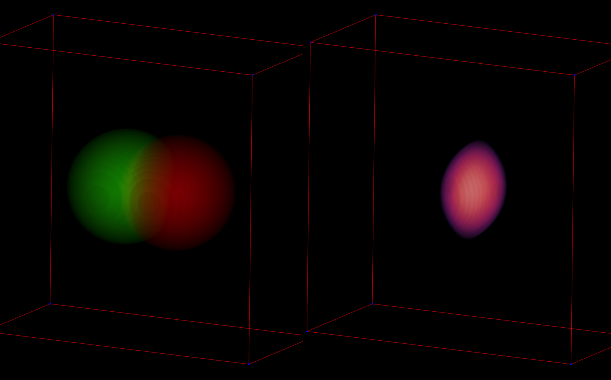
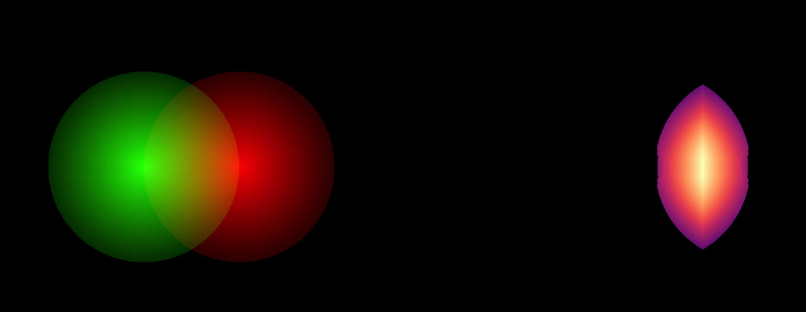

# napari-racc

`napari-racc` is a napari plugin for Regression Adjusted Colocalisation Colour
Mapping (RACC), a qualitative visualization method for 2D and 3D fluorescence
microscopy data.

The plugin takes two image layers, computes the RACC index in 3D whenever the
inputs are volumes, and adds interactive overlay, RACC, side-by-side, MIP, and
scatter-plot views to the napari viewer.

## Screenshots



3D side-by-side view with the thresholded channel overlay on the left and the
RACC volume on the right.



3D-derived maximum-intensity projection view.

## Features

- two-channel RACC calculation from napari `Image` layers
- live threshold, theta, percentile, and Costes threshold controls
- linked analysis/display cutoffs with optional display-only channel thresholds
- independent RACC display minimum without changing the numeric result
- synchronized translucent, maximum-intensity, and additive 3D rendering modes
- 3D-only intensity and RACC opacity controls, plus background suppression for
  clearer deep structures without making 2D slices or fixed MIPs faint
- transparent zero-valued RACC voxels for clean volume rendering
- thresholded RGB overlay volume with selectable probe colors
- side-by-side overlay/RACC and 3D-derived MIP views
- scatter histogram with visible axes, regression, threshold, and percentile-band overlays
- XY and Z display scale controls for metadata-light TIFF stacks
- scrollable control panel with expandable input layer selectors
- export of the numeric RACC result stack as TIFF

## Installation

Install from PyPI:

```bash
pip install napari-racc
```

For local development:

```bash
git clone https://github.com/rensutheart/napari-racc.git
cd napari-racc
uv venv --python 3.11
source .venv/bin/activate
uv pip install -e ".[dev]"
```

Fish shell users should activate the environment with:

```fish
source .venv/bin/activate.fish
```

## Usage

1. Open napari.
2. Open two image stacks or use `File > Open Sample > RACC`.
3. Start the widget from `Plugins > RACC (napari-racc)`.
4. On **Analysis**, select channel 1 and channel 2.
5. Adjust the background thresholds or press `Estimate thresholds (Costes)`.
   Thresholds use the shared 0–255 working intensity scale. Review automatic
   estimates against the image background.
6. Press `Run RACC`.
7. For volume inputs, use `3D channels`, `3D RACC map`, or `3D side by side`.
   `2D Z max projection` compares fixed maximum-intensity projections along Z.
   A short note below the buttons explains this projection. With 2D inputs,
   the first three buttons are labelled 2D and the Z-projection action is disabled.
8. On **Appearance**, expand `3D volume rendering` to adjust the rendering method,
   intensity/RACC opacities,
   and background suppression. These volume controls apply only to 3D views;
   slices and fixed Z-projections show retained pixels at full opacity.
9. Expand `Visibility filters` for channel cutoffs and the RACC minimum.
   Leave `Link channel cutoffs to analysis thresholds` enabled for a directly
   comparable intensity view, or disable it to set display-only cutoffs.
   Expand `Colors` or `Scale & bounding box` for other appearance controls.
   Appearance settings do not change the calculated or exported RACC values.
10. On Analysis, expand `Advanced method settings` for theta and percentile,
    or `Analysis diagnostics` for the scatter plot. `Update automatically`
    controls recalculation after analysis edits.
11. Press `Export RACC TIFF` to save the numeric RACC result stack for use in
    other software.

RACC is calculated over the full 3D volume when 3D inputs are used. The MIP view
is derived from the 3D calculation; it is not a 2D recalculation.

## Development

```bash
python -m npe2 validate src/napari_racc/napari.yaml
python -m ruff check src
python -m pytest
python -m build
```

Launch one example dimensionality at a time:

```bash
python scripts/launch_racc_examples.py --example 3d
python scripts/launch_racc_examples.py --example 2d
```

For a prepared presentation example, use:

```bash
python scripts/launch_racc_examples.py --example 3d --demo
```

This loads a small, explicitly labelled synthetic example, calculates RACC,
and opens the side-by-side comparison with Appearance selected. It uses no
local legacy sample files. See [the demonstration guide](https://github.com/rensutheart/napari-racc/blob/main/docs/DEMO_GUIDE.md)
for a five-minute walkthrough and technical discussion points.

Do not launch the napari viewer with `QT_QPA_PLATFORM=offscreen`; napari needs a
real Qt/OpenGL context for the viewer on macOS.

## Citation

If you use this plugin or the RACC method in research, cite:

Theart RP, Loos B, Niesler TR. Regression adjusted colocalisation colour mapping
(RACC): A novel biological visual analysis method for qualitative
colocalisation analysis of 3D fluorescence micrographs. PLOS ONE 14(11):
e0225141. <https://doi.org/10.1371/journal.pone.0225141>

## License And Patent Notice

This software is licensed under the PolyForm Noncommercial License 1.0.0. It is
source-available for noncommercial research, education, and evaluation use, but
it is not an OSI open-source license.

Use of the RACC method may be covered by patent rights, including US patent
application US20220189129A1 and related patent family members. Commercial,
clinical, diagnostic, or for-profit service use requires a separate license from
the rights holder. See `LICENSE`, `NOTICE`, and `PATENTS.md`.
